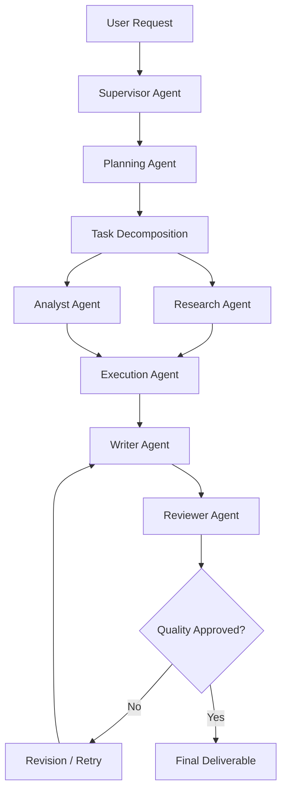

# 🚀 AgentX – Autonomous AI Workforce

### From Instructions to Execution. Multiple Agents. One Intelligent Workforce.

**AgentX** is an advanced Agentic AI platform that transforms complex user instructions into structured, executable workflows through a collaborative team of specialized AI agents.

Powered by **LangGraph, Google Gemini, and a multi-agent orchestration architecture**, AgentX can autonomously plan tasks, conduct research, analyze information, execute operations, generate deliverables, and validate results with minimal human intervention.

Unlike traditional AI chatbots that primarily generate responses, AgentX focuses on **goal-oriented execution, intelligent collaboration, and autonomous task completion.**

---

## 🌟 Project Overview

Modern workflows often require multiple steps, tools, and specialized expertise. Completing these tasks manually can be time-consuming and inefficient.

AgentX addresses this challenge by introducing a virtual AI workforce in which each agent performs a specific responsibility while collaborating through a centralized orchestration system.

Users simply describe their objectives in natural language. AgentX interprets the request, develops an execution strategy, delegates subtasks to appropriate agents, monitors progress, and delivers the final results.

### 🎯 Core Vision

Build an intelligent AI workforce capable of independently handling complex, multi-step tasks while maintaining transparency, reliability, and human oversight.

---

## ✨ Key Features

| Feature | Description |
|---|---|
| 🧠 Autonomous Planning | Converts natural-language objectives into structured execution plans. |
| 🤖 Multi-Agent Collaboration | Coordinates specialized AI agents to accomplish complex tasks. |
| 🔍 Intelligent Research | Collects, extracts, and organizes relevant information from external sources. |
| 📊 AI-Powered Analysis | Analyzes information, identifies patterns, and generates actionable insights. |
| ⚙️ Tool-Based Execution | Allows agents to interact with authorized external tools and APIs. |
| 💾 Persistent AI Memory | Stores and retrieves relevant contextual information using vector search. |
| 🔄 Self-Correction | Supports error detection, retries, and iterative output improvement. |
| 👤 Human-in-the-Loop | Requests user approval before executing sensitive or consequential actions. |
| 📄 Automated Deliverables | Generates structured reports and other task-related outputs. |
| 📡 Real-Time Monitoring | Tracks agent activities, task progress, and execution status. |

---

## 🤖 Multi-Agent Architecture

AgentX follows a specialized multi-agent architecture in which each agent has a dedicated responsibility.

| AI Agent | Responsibility |
|---|---|
| **Supervisor Agent** | Coordinates agents, manages execution flow, and delegates tasks. |
| **Planner Agent** | Breaks complex objectives into smaller, manageable subtasks. |
| **Research Agent** | Collects information and retrieves relevant external resources. |
| **Analyst Agent** | Processes collected information and identifies meaningful insights. |
| **Execution Agent** | Performs authorized operations using integrated tools and APIs. |
| **Writer Agent** | Converts findings into structured reports and deliverables. |
| **Reviewer Agent** | Evaluates output quality, checks consistency, and identifies errors. |

### How AgentX Works



The orchestrator manages agent communication, task dependencies, execution state, and workflow transitions.

---

## 🏗️ System Architecture

AgentX uses a modular architecture that separates the user interface, backend services, agent orchestration, and data storage.

```text
                 USER
                   |
                   v
             REACT FRONTEND
                   |
                   v
              FASTAPI API
                   |
                   v
          LANGGRAPH ORCHESTRATOR
                   |
        +----------+----------+
        |          |          |
        v          v          v
     PLANNER   RESEARCHER   ANALYST
        |          |          |
        +----------+----------+
                   |
                   v
             EXECUTION AGENT
                   |
                   v
               WRITER
                   |
                   v
               REVIEWER
                   |
                   v
             FINAL OUTPUT
                   |
          +--------+--------+
          |                 |
          v                 v
       MONGODB            QDRANT
```

---

## 🛠️ Technology Stack

### Frontend
- React.js
- Vite
- Tailwind CSS
- Framer Motion

### Backend
- Python
- FastAPI
- REST APIs
- WebSockets

### Agentic AI & LLM
- LangGraph – Stateful multi-agent orchestration
- Google Gemini – Large Language Model integration
- Tool Calling – External API and tool execution

### Database & Memory
- MongoDB – Application data and execution history
- Qdrant – Vector storage and semantic retrieval
- Gemini Embeddings – Text embedding generation

### Infrastructure
- Git & GitHub
- Environment-based configuration
- Vercel / Render (deployment targets)

---

## 💻 Installation & Setup

Follow these steps to run AgentX locally.

### 1. Clone the Repository

```bash
git clone https://github.com/YOUR_USERNAME/AgentX-Autonomous-AI-Workforce.git

cd AgentX-Autonomous-AI-Workforce
```

### 2. Backend Setup

Navigate to the backend directory:

```bash
cd backend
```

Create and activate a virtual environment:

**Windows:**
```bash
python -m venv venv
venv\Scripts\activate
```

**macOS / Linux:**
```bash
python -m venv venv
source venv/bin/activate
```

Install dependencies:

```bash
pip install -r requirements.txt
```

### 3. Environment Configuration

Create a `.env` file inside the backend directory using `.env.example` as a reference.

Configure the required credentials:

```env
GEMINI_API_KEY=your_gemini_api_key

MONGODB_URI=your_mongodb_connection_string

QDRANT_URL=your_qdrant_url
QDRANT_API_KEY=your_qdrant_api_key

JWT_SECRET=your_secure_jwt_secret
```

Use only the variables required by your implementation. Never commit actual credentials.

### 4. Start the Backend

From the backend directory:

```bash
uvicorn app.main:app --reload
```

Backend API:

```text
http://localhost:8000
```

API documentation:

```text
http://localhost:8000/docs
```

### 5. Frontend Setup

Open a new terminal:

```bash
cd frontend
```

Install dependencies:

```bash
npm install
```

Start the development server:

```bash
npm run dev
```

Open the local URL displayed by Vite in your terminal.

---

## 📂 Project Structure

```text
AgentX/
│
├── frontend/
│   ├── public/
│   └── src/
│       ├── components/
│       ├── pages/
│       ├── services/
│       ├── hooks/
│       └── context/
│
├── backend/
│   ├── app/
│   │   ├── agents/
│   │   ├── graph/
│   │   ├── tools/
│   │   ├── memory/
│   │   ├── api/
│   │   ├── database/
│   │   ├── models/
│   │   ├── schemas/
│   │   ├── services/
│   │   └── main.py
│   │
│   ├── requirements.txt
│   └── .env.example
│
├── docs/
├── tests/
├── .gitignore
├── README.md
└── LICENSE
```

*The structure above represents the intended modular organization; individual directories should reflect the actual implementation.*

---

## 🔮 Future Enhancements

AgentX is designed to evolve into a more capable autonomous AI ecosystem.

Planned enhancements include:

- **Dynamic Agent Selection:** Automatically select specialized agents based on task requirements.
- **Parallel Agent Execution:** Execute independent subtasks concurrently.
- **Advanced Long-Term Memory:** Improve contextual retrieval across multiple workflows.
- **Agent Evaluation Framework:** Measure agent accuracy, reliability, and performance.
- **Multi-LLM Support:** Integrate multiple LLM providers with intelligent model selection.
- **Expanded Tool Ecosystem:** Connect additional third-party services and APIs.
- **Workflow Optimization:** Improve execution efficiency, latency, and token consumption.
- **Production Deployment:** Introduce scalable infrastructure, monitoring, and observability.

---

## 🔐 Security & Reliability

AgentX aims to follow responsible AI engineering practices:

- Secure environment-variable management.
- Authentication and authorization.
- Controlled external tool execution.
- Human approval for consequential operations.
- Execution logging and error handling.
- Input validation and output verification.

---

## 🎯 Project Goals

- Explore practical applications of Agentic AI.
- Implement stateful multi-agent workflows.
- Understand autonomous planning and tool orchestration.
- Integrate LLMs with external tools and persistent memory.
- Build scalable AI-powered automation systems.

---

## 👨‍💻 Author

**Developed as an advanced Agentic AI and Multi-Agent Systems project.**

Contributions, suggestions, and feedback are welcome!

---

## 📜 License

This project is licensed under the **MIT License**. See the `LICENSE` file for details.

---

<p align="center">
  <b>AgentX – Turning Intelligent Agents into an Autonomous Workforce.</b>
</p>

<p align="center">
  ⭐ If you find this project interesting, consider giving it a star!
</p>
