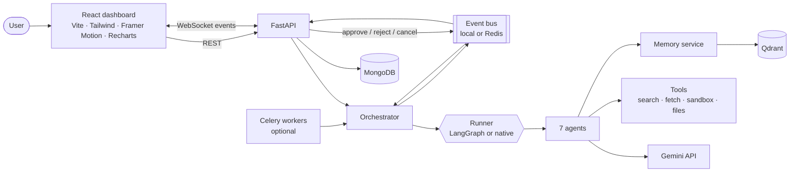
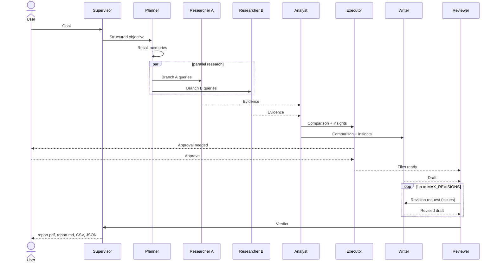
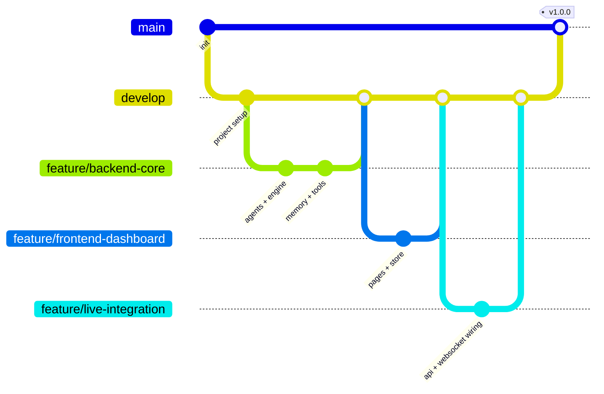

# AgentX – Autonomous AI Workforce

**Give it a goal. A team of specialised AI agents plans, researches, analyses, builds, writes and reviews the work, asks you before anything consequential, and hands back verified deliverables.**

AgentX is a multi-agent platform, not a chatbot. Seven agents with their own tools, permissions, inputs and outputs collaborate through a shared, persistent workflow state. A React dashboard shows every step live.

<!-- Add screenshots here: docs/screenshots/overview.png, task-detail.png, workflow-studio.png -->

> **Status:** the frontend runs in a built-in demo mode with no backend. The backend's core engine is covered by automated tests; the HTTP/WebSocket layer, the LangGraph runner and the real service integrations (Gemini, MongoDB, Qdrant, Redis, Celery) are written but have not yet been run end to end. See [Project status](#project-status).

---

## Table of contents

1. [Features](#features)
2. [Architecture](#architecture)
3. [The seven agents](#the-seven-agents)
4. [How a task runs](#how-a-task-runs)
5. [Tech stack](#tech-stack)
6. [Repository layout](#repository-layout)
7. [Getting started](#getting-started)
8. [Configuration](#configuration)
9. [API reference](#api-reference)
10. [Data model](#data-model)
11. [Security](#security)
12. [Testing](#testing)
13. [Git workflow and branches](#git-workflow-and-branches)
14. [Roadmap](#roadmap)
15. [Project status](#project-status)
16. [License and author](#license-and-author)

---

## Features

**Core**
- **Natural-language tasks.** Describe the outcome; AgentX interprets the objective and picks the workflow.
- **Dynamic planning.** The Planner turns the goal into a dependency-aware plan, including parallel research branches.
- **Multi-agent collaboration.** Agents hand work to each other through structured messages and a shared workflow state.
- **Live execution monitoring.** Timeline, interactive workflow graph, activity log, agent messages, per-step progress, retries.
- **Persistent AI memory.** Preferences, research findings and run history are stored and recalled in later tasks (semantic search).
- **Automated deliverables.** Markdown and PDF report, CSV comparison table, JSON evidence file, optional Excel workbook and project plan.
- **Human-in-the-loop approval.** The workflow pauses before consequential actions (writing files, posting to Slack) and waits for you to approve or reject.
- **Performance analytics.** Tokens, cost, completion rate, retries and per-agent speed and first-try success.

**Reliability**
- **Self-correction.** A failed step retries with backoff and a changed strategy (fewer queries, snippets instead of full pages, the previous error added to the prompt).
- **Reviewer loop.** The Reviewer checks citations and unsupported claims and sends the draft back to the Writer up to a configurable number of times. Unresolved issues are listed in the report under *Known limitations* instead of being hidden.
- **Evidence tracking.** Every claim carries a source and a confidence score; low-confidence claims are flagged. Facts that cite URLs the model invented are discarded.
- **Cost and safety limits.** Per-task token budget, per-step timeout, concurrent-task limit per user, cancel at any time.

**Dashboard (React)**
- Nine pages: Overview, New Task, Task History, Task Detail, Agent Workspace, Workflow Studio, AI Memory, Integrations, Analytics, Settings, plus Login.
- Dark and light themes, command palette (`Ctrl/Cmd+K`), notifications, toasts, responsive layout, keyboard and screen-reader friendly controls.

---

## Architecture



- **Runner.** LangGraph provides fan-out/fan-in control flow when installed; an equivalent native async scheduler is used otherwise. Both execute the same step logic, so behaviour is identical.
- **Event bus.** The API and the engine talk over a bus. In single-process mode it is in memory; with Redis the API and Celery workers can run separately.
- **Storage.** In-memory by default for zero-setup development; MongoDB and Qdrant when configured.

---

## The seven agents

Each agent is a worker with its own tools and permission level, not a chatbot persona.

| Agent | Role | Tools (permission) | Output |
|---|---|---|---|
| **Supervisor** | Interprets the goal, assembles the final deliverable | `workflow_state` (read/write), `agent.dispatch` (exec) | Structured objective, `report.md`, `report.pdf` |
| **Planner** | Breaks the goal into subtasks and parallel branches | `memory.search` (read), `workflow.compile` (write) | Research branches, analysis focus, report outline |
| **Researcher** | Searches, fetches and extracts facts with sources | `web.search`, `web.fetch`, `documents.retrieve` (read) | Evidence records (claim, source, quote, confidence) |
| **Analyst** | Statistics, comparison, insights | `python.sandbox` (exec), `dataframe.query` (read) | Insights, comparison table, chart specs |
| **Executor** | Generates files and performs approved actions | `files.generate` (write), `integrations.call` (**approval**) | CSV, JSON, XLSX, project plan, Slack post |
| **Writer** | Drafts the report with citations | `document.compose` (write), `citations.resolve` (read) | Markdown report |
| **Reviewer** | Checks facts, citations and completeness | `evidence.verify` (read), `agent.request_revision` (write) | Verdict, revision requests |

Model, temperature, retry count and an on/off switch are configurable per agent in the **Agent Workspace** page.

---

## How a task runs



| Step | Agent | What happens |
|---|---|---|
| n1 | Supervisor | Turns the prompt into a structured objective |
| n2 | Planner | Reads pinned and relevant memories; writes two parallel research branches, an analysis focus and an outline |
| n3, n4 | Researcher ×2 | Search, fetch pages (with SSRF protection), extract facts with source URL and confidence |
| n5 | Analyst | Computes statistics in a resource-limited subprocess; writes insights that must cite real evidence ids |
| n6 | Executor | **Approval checkpoint**, then writes CSV, JSON, XLSX and plan files |
| n7 | Writer | Markdown report that must cite `[E#]`; the *Sources* section is generated from evidence, never by the model |
| n8 | Reviewer | Fixed checks (unknown citations, uncited numbers, missing sections) plus a model judge; sends the draft back when needed |
| n9 | Supervisor | Assembles `report.md` and `report.pdf`; the run summary and best findings are saved to memory |

Task states: `queued → running → awaiting_approval → completed | failed | cancelled`.
If the API restarts mid-run, orphaned tasks are marked `failed` so you can press **Retry**.

---

## Tech stack

| Layer | Technology |
|---|---|
| Frontend | React 18, Vite, Tailwind CSS, Framer Motion, Recharts, React Router, Lucide icons |
| Backend | Python 3.11+, FastAPI, Pydantic v2 |
| Agent orchestration | LangGraph (with a native async fallback) |
| LLM and embeddings | Gemini API (REST), offline mock for development |
| Database | MongoDB (Motor), in-memory fallback |
| Vector database | Qdrant, in-memory fallback |
| Real-time | WebSockets, Redis pub/sub (optional) |
| Background jobs | Celery + Redis (optional) |
| Auth | JWT (PyJWT), scrypt password hashing |
| Files | ReportLab (PDF), openpyxl (Excel), pypdf (PDF uploads) |
| Deployment | Docker and Docker Compose; frontend suited to Vercel, backend to Render or any container host |

---

## Repository layout

Assumes one repository containing both projects:

```
agentx/
├── README.md
├── frontend/                      # React dashboard
│   ├── src/
│   │   ├── pages/                 # one file per route
│   │   ├── components/            # ui primitives, layout, workflow graph and panels
│   │   ├── lib/                   # agents, workflow templates, demo engine, seed data
│   │   ├── store/AppStore.jsx     # reducer + context (+ demo simulation clock)
│   │   └── hooks/
│   └── package.json
└── backend/
    ├── app/
    │   ├── main.py                # FastAPI app and lifespan
    │   ├── api/                   # auth, tasks, agents, memory, integrations, analytics, settings, ws
    │   ├── agents/                # supervisor, planner, researcher, analyst, executor, writer, reviewer
    │   ├── engine/                # orchestrator, runners (LangGraph, native), node execution, workflow DAG
    │   ├── llm/                   # Gemini client, offline mock
    │   ├── tools/                 # search/fetch, SSRF guard, Python sandbox, file writers
    │   ├── memory/                # memory service, vector stores, embeddings
    │   ├── db/                    # MongoDB and in-memory implementations
    │   ├── realtime/              # event bus, WebSocket hub
    │   └── worker.py              # Celery entry point
    ├── frontend-adapter/          # api.js, socket.js, store changes to go from demo to live
    ├── tests/
    ├── scripts/demo_offline.py
    ├── Dockerfile
    ├── docker-compose.yml
    └── requirements.txt
```

---

## Getting started

### Prerequisites
Node.js 18+ for the frontend; Python 3.11+ for the backend; Docker if you want the full stack.

### 1. Frontend only (demo mode)

```bash
cd frontend
npm install
npm run dev          # http://localhost:5173
```
Sign in with any email and password. A built-in simulation runs the whole workflow, including a failure and retry, an approval pause and a review round. Use the **Demo speed** control in the top bar to speed it up.

### 2. Backend only (no services, no API keys)

```bash
cd backend
python -m venv .venv && source .venv/bin/activate     # Windows: .venv\Scripts\activate
pip install -r requirements-dev.txt
python -m scripts.demo_offline                        # one full task in the terminal
cp .env.example .env
uvicorn app.main:app --reload                         # http://localhost:8000  (docs at /docs)
```
With no keys set, the API uses a mock model and in-memory storage. Outputs are placeholders; it exists so the whole pipeline can be developed and tested offline.

### 3. Real models and persistence

In `backend/.env`:
```
GEMINI_API_KEY=...        # real reasoning and embeddings
TAVILY_API_KEY=...        # real web search
MONGO_URL=mongodb://localhost:27017
QDRANT_URL=http://localhost:6333
```

### 4. Full stack with Docker

```bash
cd backend
cp .env.example .env      # set JWT_SECRET, SECRET_KEY, GEMINI_API_KEY
docker compose up --build # API :8000, Celery worker, MongoDB, Qdrant, Redis
```

### 5. Connect the frontend to the backend

Copy `backend/frontend-adapter/api.js` and `socket.js` into `frontend/src/services/`, then follow `backend/frontend-adapter/reducer-patch.md` (replace the demo clock with WebSocket events and the local actions with API calls). Create `frontend/.env`:
```
VITE_USE_MOCK=false
VITE_API_URL=http://localhost:8000/api
VITE_WS_URL=ws://localhost:8000/ws
```

---

## Configuration

Set in `backend/.env` (see `.env.example` for all options).

| Variable | Purpose | Default |
|---|---|---|
| `APP_ENV` | `production` enforces strong secrets and forbids the mock LLM | `development` |
| `JWT_SECRET`, `SECRET_KEY` | Token signing; encryption of stored integration credentials | dev placeholder |
| `GEMINI_API_KEY`, `MODEL_PRO`, `MODEL_FLASH` | Models | empty = mock |
| `TAVILY_API_KEY` | Web search | empty = mock results |
| `MONGO_URL`, `QDRANT_URL`, `REDIS_URL` | Storage and messaging | empty = in-memory / local |
| `RUN_MODE` | `inline` (single API process) or `celery` | `inline` |
| `RUNNER` | `auto`, `langgraph` or `native` | `auto` |
| `MAX_CONCURRENT_TASKS_PER_USER` | Concurrency limit | `3` |
| `MAX_REVISIONS` | Reviewer to Writer rounds | `2` |
| `NODE_TIMEOUT_S` | Per-step timeout | `300` |
| `CORS_ORIGINS` | Allowed browser origins | `http://localhost:5173` |

---

## API reference

All routes are under `/api`, authenticated with a JWT bearer token, and scoped to the calling user. Interactive docs are at `/docs` in development.

| Area | Endpoints |
|---|---|
| Auth | `POST /auth/register`, `POST /auth/login`, `GET /auth/me` |
| Tasks | `POST /tasks`, `GET /tasks`, `GET /tasks/{id}`, `POST /tasks/{id}/cancel`, `/retry`, `/approve`, `/reject`, `DELETE /tasks/{id}`, `POST /tasks/delete` |
| Planning | `POST /plan/preview` |
| Files | `GET /tasks/{id}/files/{name}`, `POST /uploads` |
| Agents | `GET /agents`, `PATCH /agents/{id}/config` |
| Memory | `GET /memory`, `POST /memory`, `POST /memory/search`, `PATCH /memory/{id}/pin`, `DELETE /memory/{id}` |
| Integrations | `GET /integrations`, `POST /integrations/{id}/connect`, `DELETE /integrations/{id}` |
| Other | `GET /analytics?days=`, `GET/PUT /settings`, `GET /notifications`, `POST /notifications/read` |
| Ops | `GET /healthz`, `GET /readyz` |

**WebSocket** `ws://host/ws?token=<jwt>` pushes `task.updated`, `log.added`, `message.added` and `notification` events.

---

## Data model

MongoDB collections: `users`, `tasks` (nodes, logs, messages, evidence and the shared workflow state are embedded), `memories`, `integrations`, `agent_configs`, `settings`, `usage_metrics` (one row per agent step), `documents` (uploads), `notifications`. Qdrant stores memory and document-chunk vectors, always filtered by user.

---

## Security

- Passwords hashed with scrypt; JWTs require an expiry; production refuses weak or default secrets and the mock LLM.
- Every query is scoped to the caller; other users' tasks, files, memories and uploads return 404.
- Integration credentials are encrypted at rest and never returned by the API.
- Web content and uploads are treated as untrusted data in prompts, and model output is validated (invented sources and unknown evidence ids are dropped). Consequential actions require approval.
- Fetching is protected against server-side request forgery: private, loopback and link-local addresses are blocked and every redirect is re-checked.
- The analysis sandbox limits CPU, memory, time and environment. It is **not** a hardened security boundary; run untrusted code only in a network-less container or a stronger isolation layer.
- Spreadsheet formula injection is neutralised in CSV and XLSX output. CORS and WebSocket origins are allow-listed. Login and sign-up are rate limited.

Report vulnerabilities privately to the repository owner rather than in a public issue.

---

## Testing

```bash
cd backend
pytest                    # 43 tests run without any external service
```
Covered: full task runs, parallel branches, retries, approval and rejection, cancellation, reviewer revision loop, token budget, memory recall, access isolation, SSRF blocking, sandbox limits, config validation. `tests/test_api.py` (HTTP and WebSocket) and `tests/test_langgraph_runner.py` run automatically once `fastapi`, `httpx` and `langgraph` are installed (`requirements-dev.txt`).

The frontend has no automated tests yet (see [Roadmap](#roadmap)).

---

## Git workflow and branches

### Branch model

| Branch | Purpose | Rules |
|---|---|---|
| `main` | Always releasable; tagged releases | Protected. Only updated by pull request from `develop` or a `hotfix/*` branch |
| `develop` | Integration branch for the next release | Protected. Updated by pull request from feature branches |
| `feature/<area>-<short-name>` | New work | Branch from `develop`, merge back by pull request |
| `fix/<short-name>` | Bug fixes | Branch from `develop` |
| `hotfix/<short-name>` | Urgent production fixes | Branch from `main`, merge into `main` and `develop` |
| `release/<version>` | Optional stabilisation before a release | Branch from `develop`, merge into `main` and `develop` |
| `docs/<short-name>`, `chore/<short-name>` | Documentation, tooling | Branch from `develop` |



### Suggested initial branches

Mapped to the project phases:

| Branch | Scope |
|---|---|
| `feature/foundation` | Repo setup, auth, FastAPI skeleton, database layer, React shell |
| `feature/agent-intelligence` | Gemini client, Supervisor, Planner, workflow DAG |
| `feature/multi-agent-system` | Researcher, Analyst, Writer, Reviewer, agent messaging |
| `feature/tools-and-memory` | Search/fetch, sandbox, Qdrant memory, file generation |
| `feature/live-dashboard` | WebSocket events, live status, workflow graph, logs |
| `feature/production-readiness` | Retries, approvals, permissions, testing, deployment |

### Commit messages

[Conventional Commits](https://www.conventionalcommits.org): `type(scope): summary`, where `type` is `feat`, `fix`, `docs`, `refactor`, `test`, `chore` or `perf`.
```
feat(engine): retry failed steps with a changed strategy
fix(api): return 404 for other users' files
docs(readme): describe the branch model
```

### Pull requests

1. Branch from `develop`, keep the change focused, and rebase on `develop` before opening the PR.
2. Run `pytest` (backend) and `npm run build` (frontend) locally.
3. Describe what changed and why, how you tested it, and include screenshots for UI changes.
4. Require at least one review and passing checks before merging; use squash merge for features to keep history readable.
5. Delete the branch after merging.

### Releases

Tag from `main` using semantic versioning (`v1.0.0`, `v1.1.0`). Increment the major version for breaking API changes, minor for new features, patch for fixes.

### Never commit

`.env` files, API keys, `node_modules/`, `dist/`, `data/` (uploaded and generated files), virtual environments and `__pycache__/`. Add them to `.gitignore` before the first commit.

---

## Roadmap

- [ ] Run and verify the backend HTTP, WebSocket and LangGraph layers against real services
- [ ] Switch the frontend from demo mode to the live API and test it end to end
- [ ] Automated frontend tests (components and key flows) and CI for both projects
- [ ] Persist LangGraph checkpoints in MongoDB or Postgres so runs survive restarts
- [ ] Agent tools for GitHub, Google Drive and email (credentials are already stored)
- [ ] Hardened sandbox for model-written code (gVisor or Firecracker)
- [ ] Redis-backed rate limiting and multi-instance deployment guide
- [ ] Evaluation suite for agent quality (citation accuracy, unsupported-claim rate)
- [ ] Two-factor authentication enforcement

---

## Project status

| Part | State |
|---|---|
| Frontend demo mode | Written; not yet built or run in a browser. Syntax and imports were checked, but run `npm install && npm run build` to confirm. |
| Backend engine, agents, memory, tools, database layer, event bus | Implemented and covered by 43 passing tests |
| Backend FastAPI routes and WebSocket | Implemented; import-checked only; tests written |
| LangGraph runner | Implemented; not executed; test written |
| Gemini, MongoDB, Qdrant, Redis, Celery | Implemented against their documented APIs; not exercised against live services |
| Frontend to backend wiring | Adapter files and instructions provided; not applied |

Treat the first run on your machine as the real test, and open an issue for anything that fails.

---

## License and author
MIT
Built by Aryan Raj.

Add a `LICENSE` file before publishing (MIT is a common choice for portfolio projects).

Built by **Aryan Raj**.
